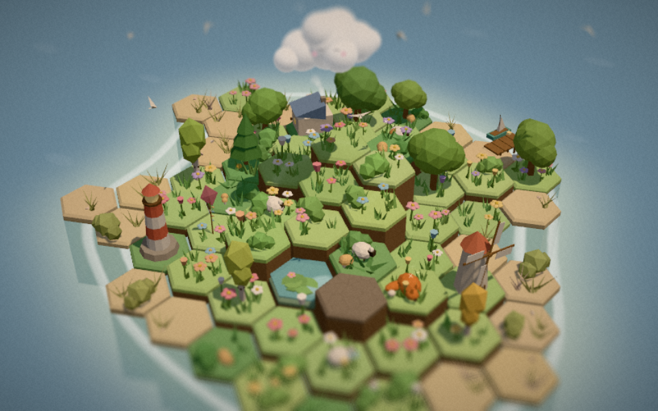

# Petrichor

*a little rain goes a long way*



You are a small raincloud with a face, drifting over a grey, parched archipelago. Hold to rain.
Soaked hex tiles darken, tremble, then **pop** into meadow, forest, marsh and blossom, and every
pop is a note in a song you're writing without trying. Over a few hours the islands fill with
rivers, villages that build themselves, sheep, birds, butterflies and fireflies, while the sky
clears from overcast ash to warm dusk.

There's no fail state, no timer and no score. It is made to be played one-handed while you listen
to something else.

See [`DESIGN.md`](DESIGN.md) for the pitches, the reasoning behind the pick, and the full design doc.

## Run it

```bash
npm install
```

```bash
npm run dev
```

Then open the printed URL (usually http://localhost:5173). For a production build:

```bash
npm run build
```

```bash
npm run preview
```

It needs a browser with WebGL2 and Web Audio (any recent Chrome, Edge, Firefox or Safari).
URL flags: `?debug` opens the tuning panel, `?lowfx` forces lighter graphics.

## Controls

| | Mouse / trackpad | Touch |
|---|---|---|
| Rain | hold left button | hold one finger |
| Move the cloud | move the pointer | drag |
| Plant a tree / splash a tile / boop a creature / collect | click | tap |
| Turn the camera | right-drag (or shift-drag) | two-finger twist / drag |
| Zoom | wheel | pinch |

Keys: **Z** zen mode (hides UI; the camera drifts slowly) · **P** photo mode · **J** journal ·
**M** mute · **`** tuning panel · **Esc** close panels · **Space** take a photo (in photo mode).

Settings include *rain without holding* (for one-handed or trackpad play) and *lighter graphics*
(no shadows or MSAA, lower resolution, for older laptops). Progress autosaves to `localStorage`.
**Start over** in settings wipes it.

## What's in it

**The core action**: hold to rain.
- The cloud follows on springs. Each puff lags at its own stiffness, so it stretches with speed and
  wobbles back together. It swells the longer you hold, widening the rain. Release after a long
  stroke and a small rainbow arcs behind it.
- A dry tile shows cracked earth. Rain darkens it, the cracks heal, it trembles when nearly full,
  and then it pops. You get a squash-and-stretch hop, a colour bloom with a flash, neighbours
  nudged, grass and flowers springing out in a stagger, a petal and leaf burst, sparkles, a tiny
  camera nod, a soft *thup* and a quantized note.
- Keep raining on living tiles and they deepen: grass, then flowers, shrubs and mushrooms, then
  trees. The plants under the cloud jiggle as the drops hit them.
- About one bloom in 25 is a *lucky* one: an extra glittering chime and a butterfly.
- Forgiving input: the rain disc is wide, nearly-soaked tiles soak faster, and a resting cursor
  lets the rain drift toward the tile closest to finishing. Each bloom gives its wet neighbours a
  sip, so soaked areas finish in chain reactions. A tap gives a concentrated splash.

**Groves and landmarks.** Each island is split into groves. When a grove reaches 84%, the rest
blooms by itself in a wave (no hunting for the last tile). Then a ripple rolls across the island,
the music swells, and a landmark assembles itself piece by piece, one rising note per piece:
cottages with chimney smoke, windmills, lantern shrines, standing stones, a great tree with a
swing, wells, a lighthouse whose beam turns at night, a pier with a bobbing boat, pagodas.

**The long arc.**

| Island | Teaches |
|---|---|
| Hearthmeadow | rain, growth |
| Wildwood | **seeds**: tap a living tile to plant a tree (the cloud sprouts a leaf) |
| Mirrormere | **springs**: rain on a glowing stone and a river runs down the terraces to the sea, blooming both banks as it goes |
| Lanternfell | **dusk**: night falls as you restore it. Flowers glow, fireflies rise, lanterns light |

Each restored island raises the next one out of the sea, and gives you a **little cloud** that
trails behind like a duckling and rains where you rain (up to four). After Lanternfell the days
start to turn on their own, and the archipelago keeps growing outward, forever.

**Endless mode.** Beyond Lanternfell each new island rises a short glide from the last, a little
larger each time. Four new kinds of shore appear among the familiar ones, each with its own palette,
plants, landmarks, sky tint, musical key and ambience:

| Theme | Look | Plants | Landmarks | Sound |
|---|---|---|---|---|
| Autumn | amber and rust | maples, pumpkins, falling leaves | barns, haystacks | A, rustling leaves |
| Frost | pale mint and white | snow-capped pines, drifting snow | igloos (with a snowman), cairns | F, ice tinkles, more wind |
| Ember | black sand and moss | ferns, glowing caps, steaming hot springs, rising sparks | stilt huts | C, bubbling springs |
| Oasis | dunes around a green heart | palms, flowering cacti | tents | E, cicadas through the day |

The music moves to an island's key on the next chord when you travel there. Each far theme has two
wonders of its own (a red squirrel, a snow hare, an ember newt, a fennec…), every other far island
can bring the wandering tortoise, and any far island may hide a message in a bottle. Gardens grow
around any home: barns, tents, stilt huts and igloos as well as cottages. To keep things light, only the
four authored islands and the four newest far islands stay loaded; older ones settle into the journal,
which counts every island restored.

**Small things.** Leave the cloud alone for a while and it dozes off (eyes closed, slow breathing,
little bubbles); it wakes with a bounce. A resting cloud still drips now and then. Tappable things
wiggle when your pointer passes over them. Finishing an island brings a petal shower.

**Kinships.** When two living things sit side by side, a third thing grows between them. You learn
the rules by watching the board, not from a menu:

| Side by side | What grows |
|---|---|
| 3 flowering tiles | a straw beehive, with bees |
| something lush (or a tree) beside water | a fern hollow with mushrooms, and a frog |
| 3 trees | a thicket with undergrowth, and a bird that stays |
| water with 2 lush banks | a reed bed with cattails, and dragonflies |
| a cottage among flowers | a cottage garden, and a villager who potters about |
| a blossom tree beside a shrine | paper lanterns that glow at dusk |

Each grove can hold one of each. They only ever add: nothing decays, and rain alone still restores
every island. Kinships you've found add a soft counter-voice to the music. What a tap plants depends
on where you tap: willows by water, blossom trees by shrines, pines in the woods.

**Visitors.** After a grove is finished, a rabbit, hedgehog or duck sometimes waits at its edge with
a thought bubble showing a recipe (🌼🌼🌼, 🌳💧…). Tap it and the spots that could answer it shimmer.
Make that kinship happen in the grove and the visitor cheers and moves in, and the grove's landmark
gains a few homely touches (window boxes and a bench, a treehouse, a pennant, hanging lanterns…).
At most two wait at a time, they never leave, and you can ignore them.

**Discoveries.** Twelve **wonders** (a sleeping fox, a lost kite, a fairy ring, an old owl, a
white stag, a heron, a glass float, a river turtle, a stone lantern, a moon lily, a shrine bell…).
Eight arrive with a particular kinship on a particular island (the fox curls up in Hearthmeadow's
first cottage garden); four are lucky finds hidden under a random tile. Tap them to keep them in the
**journal**, which also tracks kinships and hints at the wonders you're missing. Rare **golden
flowers** appear on lush tiles. Sheep go *mbaa* and jump when tapped.

**Sound.** Everything is synthesized live with Web Audio. There are no audio files.
- Generative score in D major pentatonic over an 8-chord progression at 72 bpm: a detuned,
  tape-wobbled pad, a sub drone (after your first grove), sparse generative celesta whose density
  follows your activity, and a harp figure (after your first island). Your notes are quantized in
  pitch (a stepwise random-walk melody biased to chord tones and terrain height) and in time
  (the next 16th), so they can't sound wrong.
- SFX: rain is layered band-passed pink noise that follows intensity, plus individual droplet
  *plips* (falling on soil, rising "bloops" on water). Blooms are a soft *thup* with a bubble pop
  and a leaf rustle, and the timbre varies by biome: marimba, kalimba, glass, celesta, harp. You
  also get woody *toks*, splashes, whooshes, a rumble as land rises, formant-synthesized sheep and
  a camera shutter.
- The ambience changes with the world. Sea swell and wind at first; the wind fades as life
  returns. Birdsong rises with vitality, frogs appear near ponds, river gurgle follows the number
  of rivers, and crickets come at night.

**Look.** Soft low-poly dioramas on terraced hex columns. A single finishing pass applies
tilt-shift (the focus band follows the cloud), a saturation and warmth grade that rises with
world vitality, a vignette and grain. You also get an overcast sky that clears as the world
recovers, a time-of-day palette with stars, a translucent sea that shows submerged islands as
hints, lapping foam and sea ripples, and wind-swayed vegetation.

## Photo mode, zen and tuning

- **Photo mode (P):** frees the camera (left-drag to orbit), hides the UI, adds focus, blur and
  time-of-day sliders and four filters (soft, film, dream, mono), and saves a PNG.
- **Zen mode (Z):** hides everything and lets the camera drift in a slow orbit.
- **Tuning panel (` or `?debug`):** live sliders for tile, decor and cloud spring stiffness and
  damping, impulses, decor stagger, wind, rain radius, charge, soak rate, magnetism, life spread,
  grove auto-finish threshold, drop rate, camera kick, follow and FOV, particle counts, tilt-shift,
  grain, vignette, volumes and time scale. It also has shortcuts (bloom island, finish grove,
  unlock next island, lush everything) and an fps/particle readout.

## Code tour

```
src/
  core/      config (all tunables), springs/noise/rng, hex math, shared shader patches
  audio/     engine (buses, reverb, instrument voices), generative music, sfx + ambience
  world/     island generation (+ endless layout), island themes, island rendering + tile springs,
             instanced decor, models, landmarks, creatures, critters, wonders, kinship data,
             sky/sea/lighting
  fx/        particles, rain, post-processing
  game/      game orchestration + progression, ecosystem (kinships, visitors), cloud(s),
             camera rig, input, save
  ui/        DOM UI (title, HUD, journal, settings, photo bar) and the tuning panel
```

Every animated value is a damped spring (sub-stepped at 240 Hz, so it's stable at any frame rate)
or an overshoot curve. There are no linear tweens. Tiles, decor and creatures are instanced, so a
fully grown archipelago stays at a few dozen draw calls. Resolution adapts if the frame rate dips.
